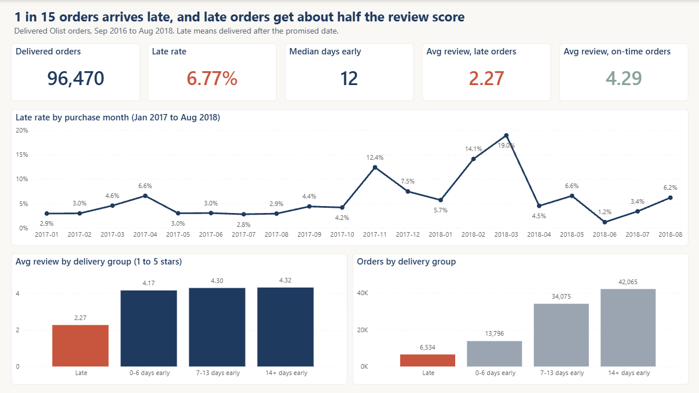
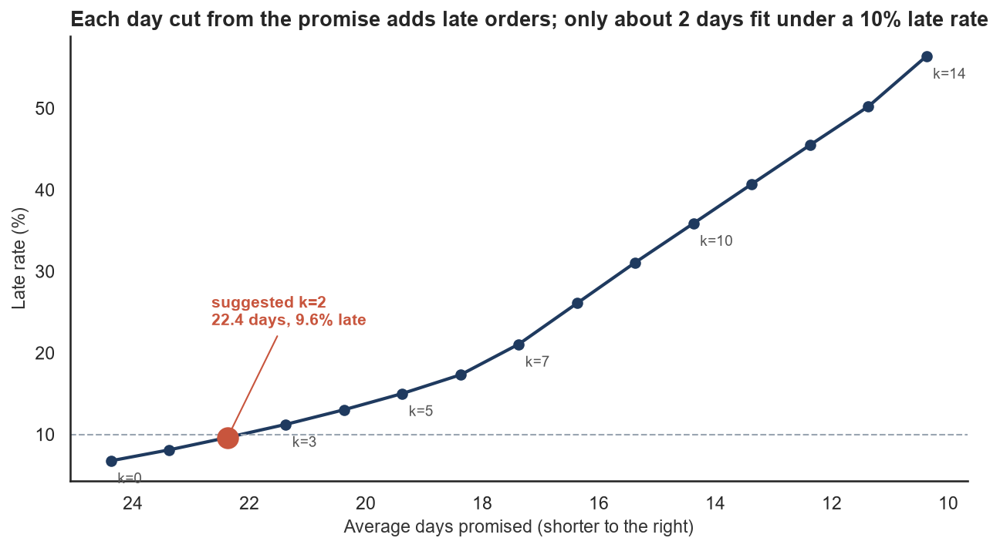
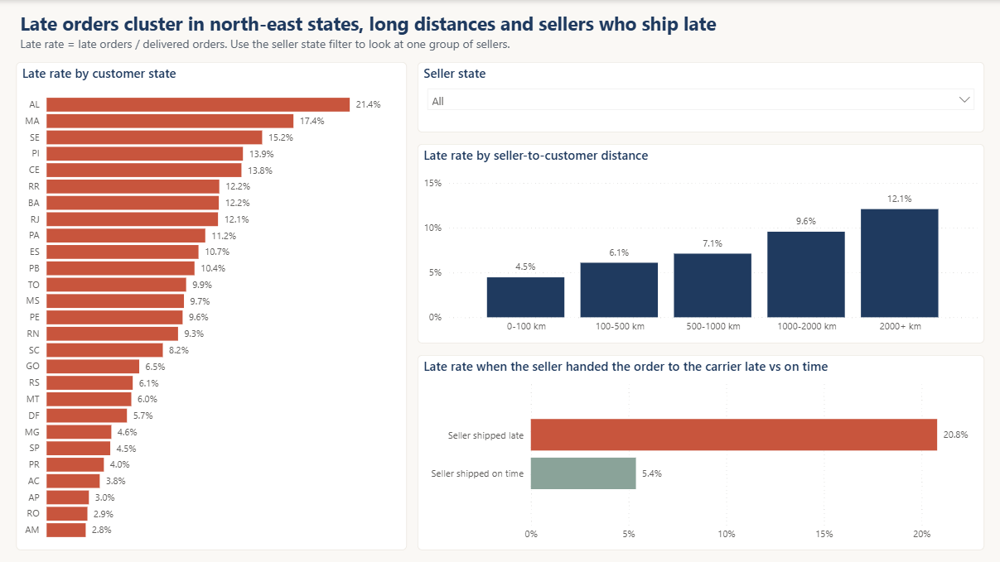
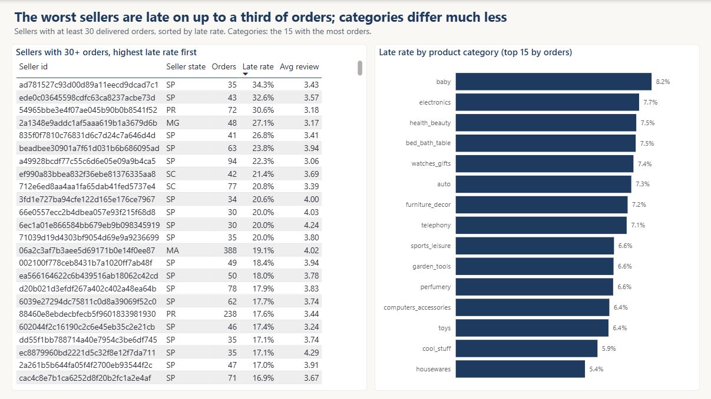
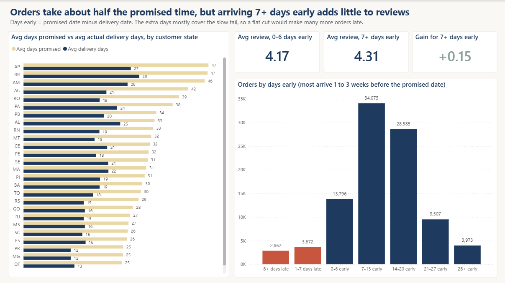

# The Delivery Gap

Olist, a Brazilian online marketplace, shows every customer a promised delivery date. I wanted to know how often that promise is missed, where late orders come from, what a late order costs in reviews, and whether the promise itself is set too far out.

I loaded the Olist data (about 99,000 orders from 2016 to 2018, 9 tables) into PostgreSQL, did most of the analysis in SQL, checked the main results with statistical tests in Python, and built a Power BI dashboard.



## What I found

- **6.8% of delivered orders arrived late** (6,534 of 96,470).
- **Late orders get much worse reviews.** The average score is 2.27 for late orders against 4.29 for the rest, and 62.4% of late orders got 1 or 2 stars.
- **Most orders arrive far earlier than promised.** The median order arrives 12 days early, and 79% arrive a week or more early.
- **Arriving very early does not earn better reviews.** Orders that came 7 to 13 days early scored 4.30 and orders 14 or more days early scored 4.32, almost the same as each other. Being early past a week does not make customers happier.
- **The tests back this up.** A chi-square test of late orders against 1-2 star reviews gives chi-square = 15,064 (p < 0.001) with Cramer's V = 0.40, a strong link. A Mann-Whitney test on the review scores agrees (p < 0.001).

- **But a flat cut would backfire.** If every promise were 3 days shorter, the late rate would go from 6.77% to 11.23%. At 7 days shorter it would be 21.07%. Delivery times vary a lot: one order in ten arrives only 2 days early or less. So the long promise is not plain padding. It mostly covers the slow tail of deliveries.
- **Most late orders are late in transit, not at the seller.** When the seller handed the parcel over late, 20.8% of orders arrived late, against 5.4% otherwise. Still, about 72% of late orders were handed over on time.
- **Distance and route matter more than product.** The late rate rises from 4.5% for the closest fifth of orders to 9.7% for the farthest. It is 8.1% when seller and customer are in different states and 4.5% within the same state. Customers in MA, CE, BA and RJ wait the most often (12-17% late). Product category hardly matters: the main categories are all between 7% and 8%.
- **Late spikes come in waves.** The late rate is usually 3-7% a month, but it reached 12.4% in November 2017 (Black Friday) and 19.0% in March 2018.
- **A late first order means fewer repeat buyers, though repeat buying is rare anyway.** 2.53% of customers whose first order was late placed a second order, against 3.03% when it was on time. The effect is tiny (Cramer's V = 0.007), so I treat it as a hint, not a finding.

## Recommendation

1. **Fix lateness where it starts.** Push sellers to hand parcels over by their ship-by date, plan extra carrier capacity before peak months, and look at the slow routes to the north-east (MA, CE, BA) and to RJ.
2. **Don't shorten every promise by the same amount.** Even 3 days shorter would make 11.2% of orders late instead of 6.8%.
3. **Shorten promises only where delivery is fast and steady**, for example orders within the same state or under 500 km, and set them by route instead of one rule for everyone. In a rough test I learned the delivery times from 2017 and set each state's promise at the 90th percentile. On 2018 orders the promise came down from 23.4 to 20.9 days, but lateness rose from 7.7% to 10.2%. So any change should be tried on a small share of orders first.



## How I did it

1. **Database.** Created the 9 tables in PostgreSQL with primary and foreign keys, loaded the CSV files with `\copy`, and checked the row counts ([sql/01_create_tables.sql](sql/01_create_tables.sql), [sql/02_load_data.sql](sql/02_load_data.sql)).
2. **One clean row per order.** A view joins orders, customers, sellers, items, products and reviews, and works out delivery days, days early or late, distance from seller to customer and whether the seller shipped late ([sql/03_views.sql](sql/03_views.sql)).
3. **SQL analysis.** 20 queries using joins, CTEs, window functions and percentiles ([sql/04_analysis_queries.sql](sql/04_analysis_queries.sql)).
4. **Python.** A notebook with charts, a chi-square test, a Mann-Whitney test and a simple what-if on shorter promises ([notebooks/delivery_gap_analysis.ipynb](notebooks/delivery_gap_analysis.ipynb)).
5. **Power BI.** A 4-page dashboard built on the clean order table ([powerbi/](powerbi/)).

## Dashboard

Four pages, built in Power BI Desktop on the clean order table. Details of the pages and the 15 DAX measures are in [powerbi/README.md](powerbi/README.md).

**Where late orders come from**



**Sellers and categories**



**How long is the promise**



## Run it yourself

1. Download the data from Kaggle into `data/raw` (see [data/README.md](data/README.md)).
2. Create a PostgreSQL database called `olist`, then run the SQL files in order from this folder:
   ```
   psql -h localhost -U <your user> -d olist -f sql/01_create_tables.sql
   psql -h localhost -U <your user> -d olist -f sql/02_load_data.sql
   psql -h localhost -U <your user> -d olist -f sql/03_views.sql
   ```
3. Run the queries in `sql/04_analysis_queries.sql`, or open the notebook (`pip install -r requirements.txt`).
4. For the dashboard, open `powerbi/DeliveryGap.pbip` in Power BI Desktop and set the data folder parameter (see [powerbi/README.md](powerbi/README.md)).

## Limits

- This shows association, not cause. Late orders and bad reviews go together, but other things (like the product itself) also affect reviews.
- The data is one marketplace in 2017 and 2018. 2016 has only a few hundred orders, so monthly trends start in January 2017.
- Only some customers leave reviews, and they may not be typical.
- The what-if on shorter promises assumes delivery times stay the same.

## Tools

PostgreSQL, SQL, Python (pandas, SciPy, Matplotlib), Power BI (Power Query, DAX).

Data: [Brazilian E-Commerce Public Dataset by Olist](https://www.kaggle.com/datasets/olistbr/brazilian-ecommerce) on Kaggle, CC BY-NC-SA 4.0.
